

<picture><source media="(prefers-color-scheme: dark)" srcset="assets/hero-dark.svg"></picture>
<picture><source media="(prefers-color-scheme: dark)" srcset="assets/social-l-dark.svg"></picture><a href="https://t.me/ayazaliofc"><picture><source media="(prefers-color-scheme: dark)" srcset="assets/social-1-dark.svg"></picture></a><a href="https://www.youtube.com/@ayazaliofc"><picture><source media="(prefers-color-scheme: dark)" srcset="assets/social-2-dark.svg"></picture></a><a href="https://www.reddit.com/user/ayazaliofc"><picture><source media="(prefers-color-scheme: dark)" srcset="assets/social-3-dark.svg"></picture></a><a href=""><picture><source media="(prefers-color-scheme: dark)" srcset="assets/social-4-dark.svg"></picture></a><a href=""><picture><source media="(prefers-color-scheme: dark)" srcset="assets/social-5-dark.svg"></picture></a><picture><source media="(prefers-color-scheme: dark)" srcset="assets/social-r-dark.svg"></picture>
<picture><source media="(prefers-color-scheme: dark)" srcset="assets/about-dark.svg"></picture>
<picture><source media="(prefers-color-scheme: dark)" srcset="assets/stack-dark.svg"></picture>
<a href="https://github.com/ayazaliofc/ayazaliofc"><picture><source media="(prefers-color-scheme: dark)" srcset="assets/project-ayazaliofc-dark.svg"></picture></a> <a href="https://github.com/ayazaliofc?tab=repositories"><picture><source media="(prefers-color-scheme: dark)" srcset="assets/project-1-dark.svg"></picture></a>
<a href="https://github.com/ayazaliofc?tab=repositories"><picture><source media="(prefers-color-scheme: dark)" srcset="assets/project-2-dark.svg"></picture></a> <a href="https://github.com/ayazaliofc?tab=repositories"><picture><source media="(prefers-color-scheme: dark)" srcset="assets/project-3-dark.svg"></picture></a>
<a href="https://github.com/ayazaliofc?tab=repositories"><picture><source media="(prefers-color-scheme: dark)" srcset="assets/project-4-dark.svg"></picture></a> <a href="https://github.com/ayazaliofc?tab=repositories"><picture><source media="(prefers-color-scheme: dark)" srcset="assets/project-5-dark.svg"></picture></a>
<picture><source media="(prefers-color-scheme: dark)" srcset="assets/stats-dark.svg"></picture>
<picture><source media="(prefers-color-scheme: dark)" srcset="assets/streak-dark.svg"></picture>
<picture><source media="(prefers-color-scheme: dark)" srcset="assets/wave-dark.svg"></picture>
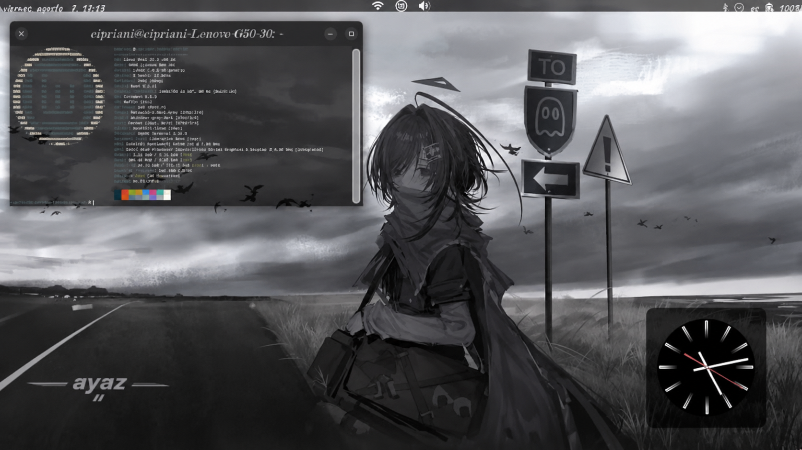

